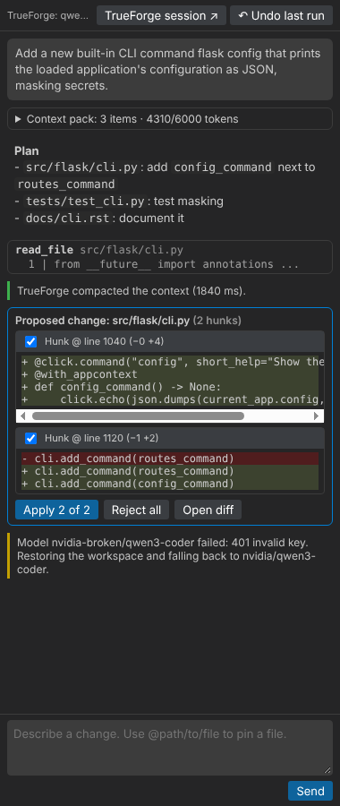

# TrueForge Coder

A VS Code extension for AI-assisted editing whose **entire agent loop runs on [TrueForge](https://github.com/truefoundry/trueforge)**.
Built from scratch for the TrueFoundry Forge-a-thon (Techfest IIT Bombay 2026-27), Round 1. MIT licensed.

- **Inline edit** (`Cmd/Ctrl+Alt+K`): select code, type an instruction, review the proposed diff hunk by hunk, accept or reject each hunk.
- **Agent panel**: one request drives a TrueForge agent through a tool loop (find, read, search, propose edits, run a command). The agent finds the files itself.
- **Context assembly**: `@file` and `@symbol` mentions plus automatic, budgeted retrieval over the whole workspace. The panel shows what was chosen and why.
- **Diff review and undo**: every write is shown as hunks with a live native diff; nothing reaches disk without your approval; **Undo last run** reverts a whole run.
- **Streaming and cancellation**: tokens stream from TrueForge events; **Stop** is immediate and a cancelled run is all-or-nothing.
- **Resilience**: retry with back-off, then automatic fallback to the next configured model, restoring the workspace first.

The extension never talks to a model provider. It is a client of a local TrueForge: it creates sessions, sends turns, renders the streamed events, and exposes the editor to the agent as MCP tools.

## How it fits together

```
┌────────────────────────── VS Code ───────────────────────────┐          ┌──────────── TrueForge (local, :8790) ───────────┐
│  Chat panel (webview)     Inline edit      Native diff editor │          │  Session / turn / events (SSE)                  │
│        │                       │                  ▲          │  HTTP    │  Agent loop, subagents, compaction, approvals   │
│        ▼                       ▼                  │          │ ───────▶ │  Model providers (NVIDIA build.nvidia.com)      │
│  ForgeRunner (TS SDK) ── retry / backoff / fallback│          │ ◀─────── │                                                 │
│        ▲                                          │          │  stream  └───────────────┬─────────────────────────────────┘
│        │ tool.approval_required                   │          │                          │ MCP (Streamable HTTP, 127.0.0.1:8791)
│  Review UI ── user picks hunks ──▶ Approval ledger│          │                          ▼
│                                         ▲         │          │        ┌─────────────────────────────────────────────┐
│  Editor MCP server  ◀───────────────────┴─────────┼──────────┼────────│ find_relevant_code  read_file  list_dir     │
│  (runs inside the extension host)                 │          │        │ search_code  propose_edit  write_new_file   │
└───────────────────────────────────────────────────┘          │        │ run_command                                 │
                                                               │        └─────────────────────────────────────────────┘
```

**Approval-driven diff review.** `propose_edit`, `write_new_file` and `run_command` are gated by TrueForge's tool approval (`require_approval_for_tools`). When the agent calls one, the turn pauses with `tool.approval_required`. The extension computes the hunks, you accept or reject each one, the decision is recorded in an in-process *approval ledger*, and only then is `user.tool_approval` sent back. The MCP tool applies exactly the accepted hunks. As defence in depth the tool itself refuses to write unless the ledger holds a matching grant (and refuses if the file changed since you reviewed it), so a write can never happen silently, even if the approval gate were bypassed.

| MCP tool | Purpose | Read-only | Approval |
|---|---|---|---|
| `find_relevant_code` | task-level retrieval over the whole workspace (same engine as auto-context) | yes | no |
| `read_file` | numbered lines, paged | yes | no |
| `list_dir` | directory listing | yes | no |
| `search_code` | regex search with optional glob | yes | no |
| `propose_edit` | search/replace edits to one file, applied hunk by hunk after review | no | **yes, per-hunk review** |
| `write_new_file` | create a file, reviewed the same way | no | **yes, per-hunk review** |
| `run_command` | run a shell command in the workspace (e.g. tests) | no | **yes, modal confirmation** |

## Quick start (from a clean clone)

Requirements: **Node.js ≥ 22.14** (TrueForge requirement), VS Code ≥ 1.90, git, and a free NVIDIA API key from <https://build.nvidia.com>.

```bash
git clone https://github.com/Hacker-web25/trueforge-coder.git
cd trueforge-coder
npm install
npm run build          # bundles the extension into dist/
npm run package        # creates trueforge-coder-0.1.0.vsix
code --install-extension trueforge-coder-0.1.0.vsix
```

(Alternative: open this folder in VS Code and press **F5** to launch an Extension Development Host.)

### 1. Start TrueForge locally

```bash
OUTBOUND_URL_ALLOWED_HOSTS='["127.0.0.1","localhost"]' npx @truefoundry/trueforge@latest
# TrueForge UI + API: http://localhost:8790
```

The allow-list is required: TrueForge ships an SSRF guard that blocks `localhost` for MCP servers, and our editor tool server is a local MCP server. Only the loopback hosts are allowed.

### 2. Configure the model (free NVIDIA tier) and load the agent definition

```bash
NVIDIA_API_KEY=nvapi-... node scripts/setup-trueforge.mjs
```

This registers an OpenAI-compatible provider named `nvidia` in your local TrueForge, registers the editor MCP connector `vscode-editor`, and saves the agent definitions in [`agent/`](agent/) (`forge-coder`, `forge-coder-inline`). The key is read from the environment and is sent only to your local TrueForge.

No terminal? Either run the VS Code command **TrueForge Coder: Set Up NVIDIA Models** (the key is entered in a password box), or add a custom OpenAI-compatible provider named `nvidia` with base URL `https://integrate.api.nvidia.com/v1` in TrueForge → Settings → Models. [`agent/models.example.json`](agent/models.example.json) shows the intended configuration. **Never commit keys.**

### 3. Use it

Open a folder (for the Flask demo: `git clone https://github.com/pallets/flask && cd flask && git checkout 3.1.3`, then `python -m venv .venv && . .venv/bin/activate && pip install -e . pytest` and open the folder in VS Code). Set `trueforgeCoder.commandPreamble` to `. .venv/bin/activate &&` so approved commands run inside the virtualenv.

- **Inline edit**: select code, `Cmd+Alt+K` (or right-click → *TrueForge Coder: Inline Edit*), type the instruction. A native diff opens beside a hunk list; untick hunks to reject them, press Enter to apply.
- **Agent panel**: activity bar → TrueForge Coder (or `Cmd+Alt+L`). Type a request; use `@path/to/file.py` or `@symbol_name` to pin context. Review each hunk card (checkbox per hunk, live diff), then **Apply**.
- **Stop** cancels immediately. **Undo last run** reverts every file the last run changed.
- **TrueForge session** opens the run in the TrueForge UI (turns, tool calls, subagents, compaction).
- **Switch models**: *TrueForge Coder: Choose Model / Fallback Chain* (or edit `trueforgeCoder.models`, an ordered list such as `["nvidia/nemotron-3-5-lightning","nvidia/nemotron-3-ultra"]`).

## How context is selected

Budget: `trueforgeCoder.contextBudgetTokens` (default **6,000 tokens**, estimated as chars/4). Order of priority:

1. **Explicit mentions** (`@file`, `@symbol`), up to 60% of the budget.
2. **Selection / active file** (the selected lines verbatim; otherwise only the active file's path).
3. **Automatic retrieval** over the whole workspace for the remaining budget:
   - chunk every file into function/class-sized pieces (headings for docs); skip vendored and generated directories;
   - rank with **BM25** over chunk text, with the symbol name weighted ×3 and the path ×2; identifiers are split on snake_case/camelCase, so "debug flag" finds `get_debug_flag`; backticked and identifier-looking query terms weigh more than ALL-CAPS constants;
   - a file-level coverage multiplier prefers files that match several distinct query terms;
   - **co-change neighbours**: the test file and doc page sharing a module name with a hit (`src/flask/cli.py` → `tests/test_cli.py`, `docs/cli.rst`), because multi-file edits need them;
   - pack greedily into the remaining budget with a per-file diversity penalty (0.75^k), so one big file cannot crowd out the others.
4. Every item records **why it was chosen**; the panel shows the list ("Context pack: N items · used/budget tokens"), and the same pack is part of the user message, so it is visible in the TrueForge session.

Beyond the pack, the agent can call `find_relevant_code`, `search_code` and `read_file` itself. On Flask 3.1.3 (205 files, ~2,300 chunks) the index builds in ~150 ms and a query takes ~20 ms.

### TrueForge context-engineering features in use

- **Subagents** (`create_sub_agent`, dynamic sub-agents enabled): the agent definition tells the main agent to delegate read-only exploration so raw file contents stay out of its own context.
- **Context compaction**: enabled with an early trigger (`trueforgeCoder.compactionTriggerTokens`, default 16,000 input tokens) because free-tier models slow down and hit rate limits on long contexts. Compaction start/finish events are surfaced in the panel and are visible in the TrueForge session.
- **Large tool-response handling** is enabled so a big `read_file` or `search_code` result does not flood the context.

## Resilience

`ForgeRunner` creates one TrueForge session per attempt. If a model call fails (bad key, outage, rate limit) it restores the workspace from the run's checkpoint, retries with exponential back-off (`trueforgeCoder.retries`, default 1), then falls back to the next model in `trueforgeCoder.models` and finally reports a clear error. The editor stays responsive throughout (all work is asynchronous; Stop is always available).

To reproduce Task C: `NVIDIA_API_KEY=... node scripts/setup-trueforge.mjs --broken` registers `nvidia-broken` (deliberately invalid key). Set `trueforgeCoder.models` to `["nvidia-broken/nemotron-3-5-lightning"]` for the "clear message, nothing changed" case, or `["nvidia-broken/nemotron-3-5-lightning","nvidia/nemotron-3-5-lightning"]` to watch the automatic fallback.

## Settings

| Setting | Default | Meaning |
|---|---|---|
| `trueforgeCoder.baseUrl` | `http://localhost:8790` | your local TrueForge |
| `trueforgeCoder.mcpPort` | `8791` | port of the editor MCP server (next free port is used if busy) |
| `trueforgeCoder.models` | `["nvidia/nemotron-3-5-lightning","nvidia/nemotron-3-ultra"]` | ordered model chain (primary, then fallbacks) |
| `trueforgeCoder.contextBudgetTokens` | `6000` | automatic context budget |
| `trueforgeCoder.compactionTriggerTokens` | `16000` | TrueForge compaction trigger |
| `trueforgeCoder.retries` | `1` | retries per model before falling back |
| `trueforgeCoder.rollbackOnCancel` | `true` | Stop reverts files the cancelled run already changed (all-or-nothing) |
| `trueforgeCoder.autoApproveCommands` | `false` | run agent commands without the confirmation dialog (file edits are always reviewed hunk by hunk) |
| `trueforgeCoder.commandPreamble` | `""` | prefix for approved commands, e.g. `. .venv/bin/activate &&` |

## Tests

```bash
npm test      # needs TrueForge running locally (see step 1); uses a scripted fake model, no API key
```

23 tests: hunk composition, edit planning, approval ledger and stale-write guard, checkpoints/undo, `@file`/`@symbol` context, retrieval budget, and end-to-end runs through a **real local TrueForge** (approval pause/resume, per-hunk apply, reject-all, refusal without approval, cancel, fallback) plus a headless run of the *bundled extension* and its chat panel (jsdom) against a stand-in for the `vscode` API, and (with `FLASK_DIR` set) a golden run of Tasks A and B on the real Flask 3.1.3 repo.

## Reproduce the demo (Flask 3.1.3)

See [`demo/DEMO_SCRIPT.md`](demo/DEMO_SCRIPT.md) (pre-flight, timeline for Tasks A, B and C, troubleshooting) and [`demo/prepare-flask.sh`](demo/prepare-flask.sh) (clones Flask at tag 3.1.3, creates the virtualenv with the pytest version Flask locks, runs the baseline). A code walkthrough for reviewers is in [`docs/WALKTHROUGH.md`](docs/WALKTHROUGH.md).



## Layout

```
src/core/        VS Code-free logic: retrieval, hunks, ledger, editor tools, MCP server, TrueForge runner, review, checkpoints, context pack
src/vscode/      thin VS Code glue: host (WorkspaceEdit), diff documents, review UIs, chat view
media/           chat panel (plain JS/CSS)
agent/           TrueForge agent definitions and example model configuration
scripts/         setup-trueforge.mjs (provider + connector + agents)
test/            unit, end-to-end (real TrueForge) and headless UI tests
```

## Fork point

**From scratch.** No upstream repository; TrueForge and the MCP SDK are used as dependencies (`@truefoundry/trueforge-sdk`, `@modelcontextprotocol/sdk`).

## Known limitations

See the write-up. Short version: free-tier model quality and rate limits, retrieval is lexical (no embeddings), mostly tested headlessly rather than by a human on every VS Code version, no tab completion (out of scope).

## License

MIT, see [LICENSE](LICENSE).
